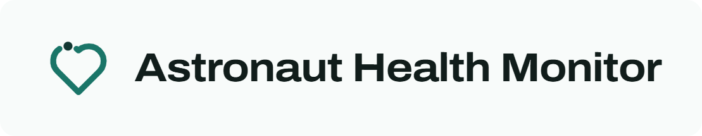
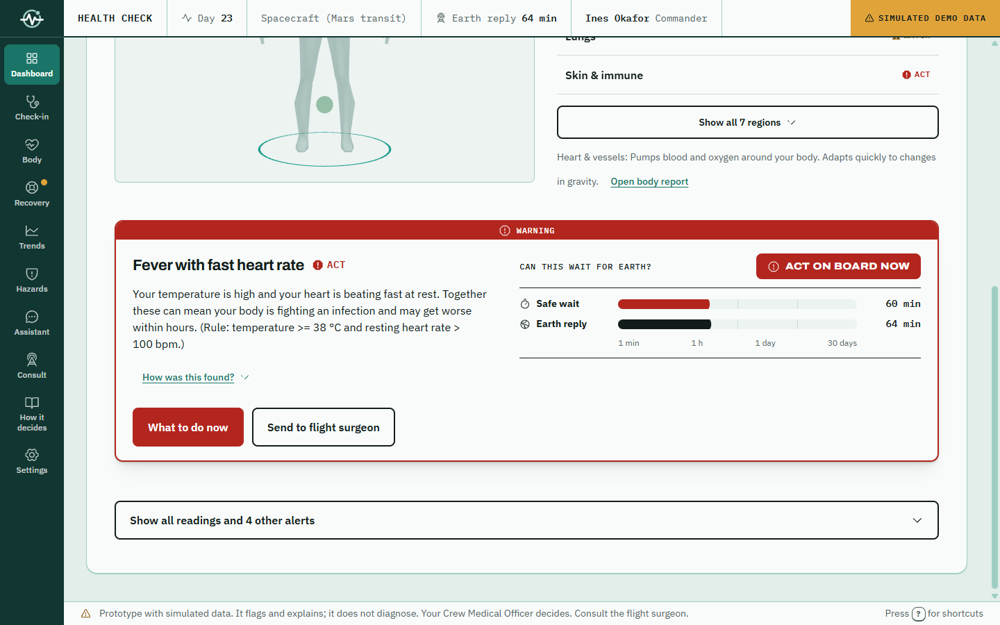
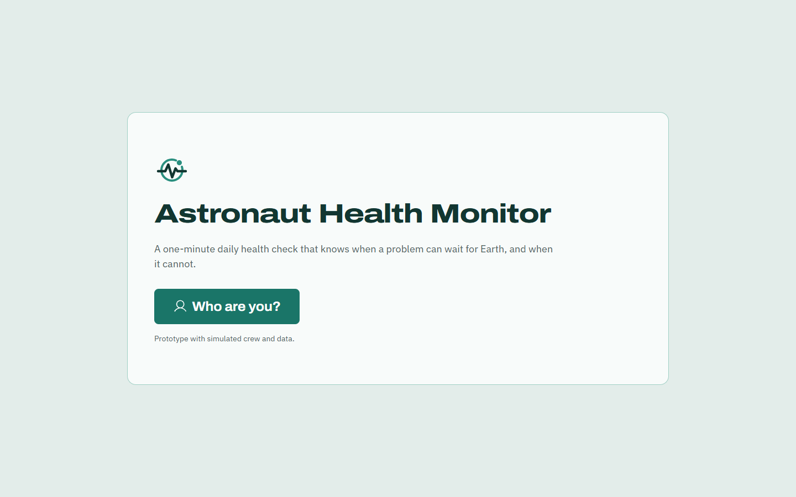
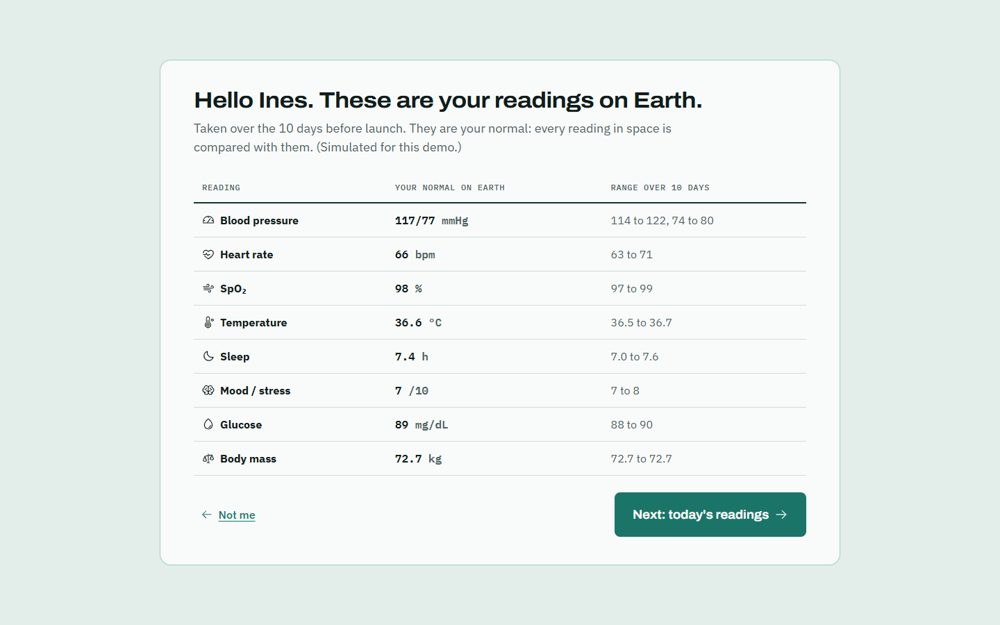
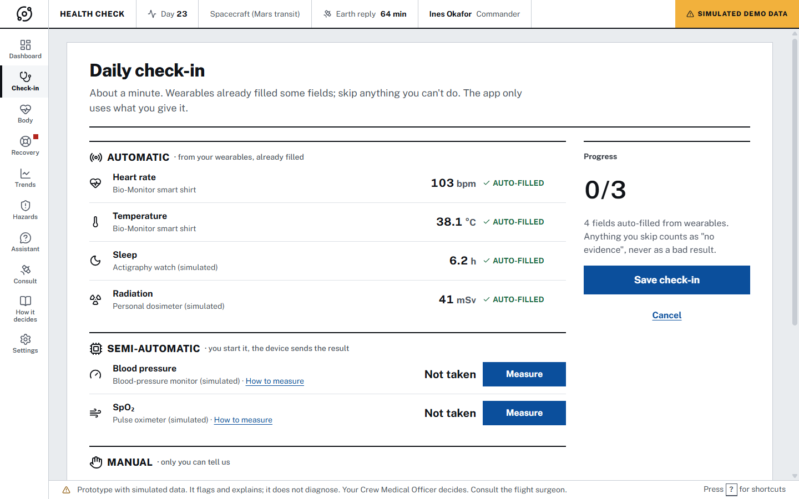
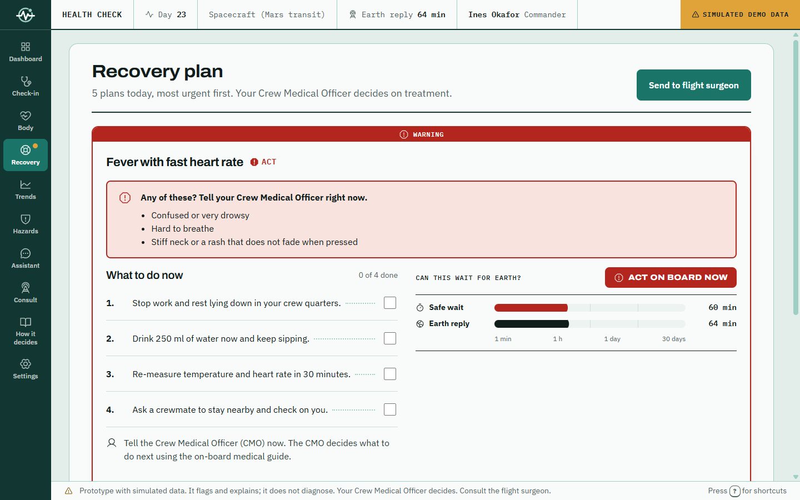
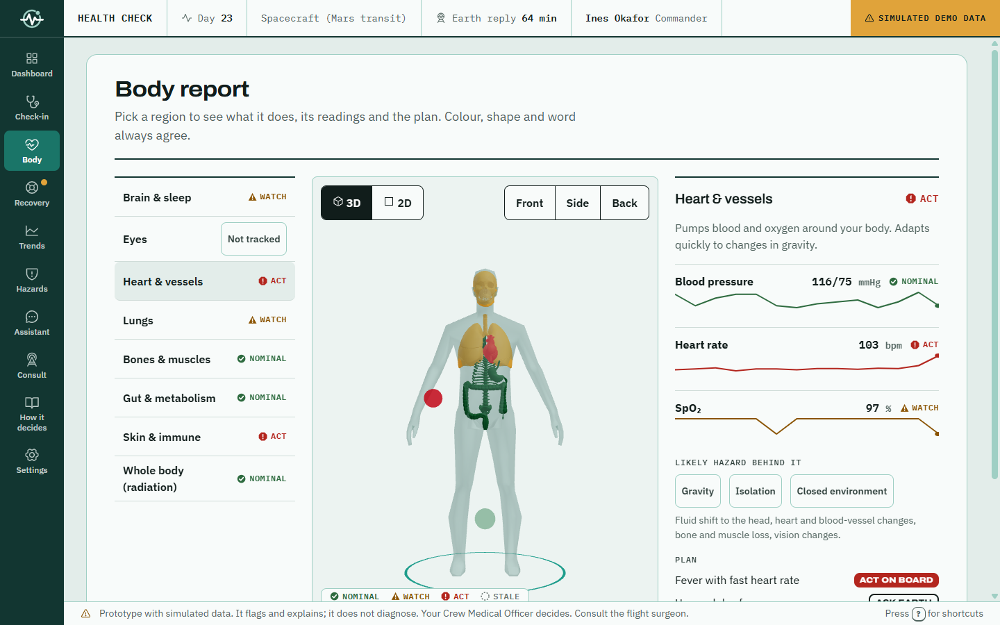
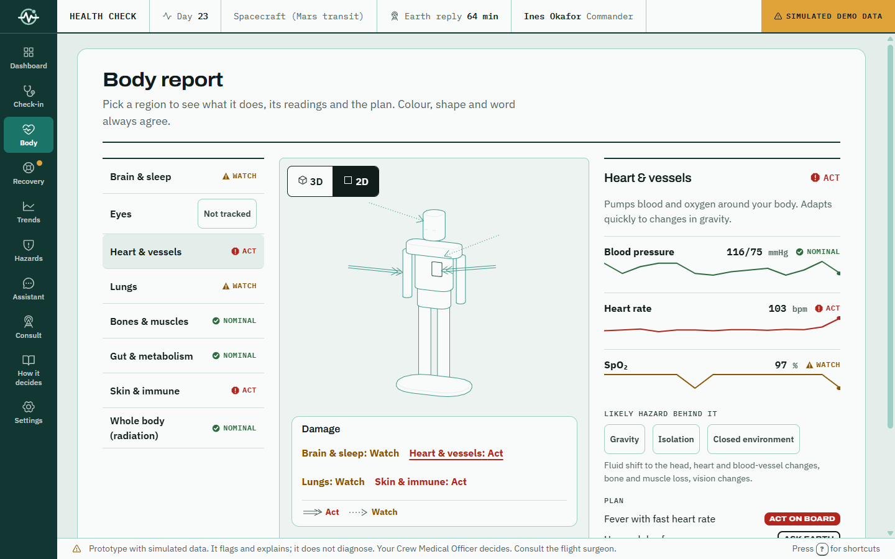
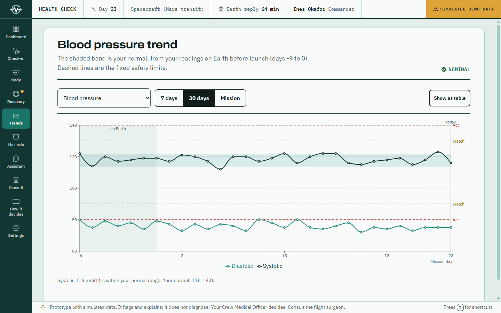
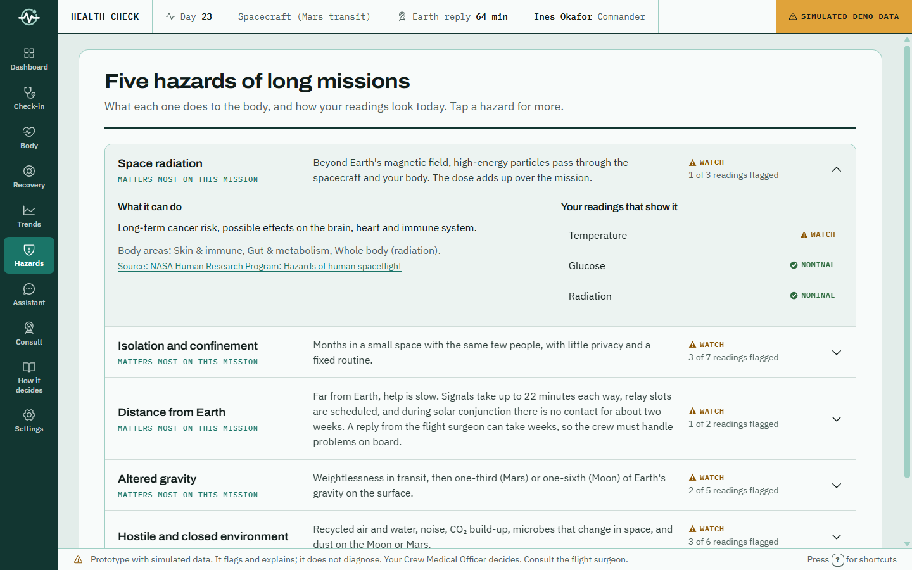

<p align="center"></p>

<h1 align="center">Astronaut Health Monitor</h1>

<p align="center"><b>A full desktop app for Windows, macOS and Linux</b> · NASA Space Apps 2026 · simulated data</p>

<p align="center">
  <a href="https://lordxmanoj.github.io/Nasa-space-app/"><b>⬇ Download the app</b></a>
  &nbsp;·&nbsp; <a href="https://github.com/LORDXMANOJ/Nasa-space-app/releases/latest">All installers</a>
  &nbsp;·&nbsp; <a href="docs/ux/README.md">Why it is designed this way</a>
</p>

On long missions, help from Earth is minutes to weeks away. This app is a one-minute daily health check-in for astronauts. It flags changes against each astronaut's **own normal** (learned from readings taken on Earth before launch), explains them in plain English, and answers one question: **can this wait for Earth?**

> Not a medical device. It flags and explains; it does not diagnose and never gives doses. The Crew Medical Officer decides.



## Download

The [download page](https://lordxmanoj.github.io/Nasa-space-app/) detects your system and offers the right installer.

| Your computer | Installer | What it does for your system |
|---|---|---|
| **Windows** 10 / 11 | `AstronautHealthMonitor-Windows-Setup.exe` | One installer carrying x64 and ARM64; it installs the build that matches your PC, for your user only (no administrator rights), with Start-menu and desktop shortcuts |
| **macOS** | `AstronautHealthMonitor-macOS.dmg` | One universal app: native on Apple silicon and Intel Macs |
| **Debian, Ubuntu, Mint** | `AstronautHealthMonitor-Linux-amd64.deb` (and `-arm64.deb`) | `sudo apt install ./file.deb` |
| **RHEL, Rocky, Alma, Fedora, SUSE** | `AstronautHealthMonitor-Linux-x86_64.rpm` (and `-aarch64.rpm`) | `sudo dnf install ./file.rpm` (SUSE: `zypper`) |
| **Any other Linux** | `AstronautHealthMonitor-Linux-x86_64.AppImage` (and `-arm64.AppImage`) | `chmod +x`, then run; no install |

Linux packages follow what space programmes run: the ISS laptop network moved to **Debian**; **Red Hat Enterprise Linux** runs on ISS edge computers and Orion flight-software simulations; ESA's ground stations use **SUSE**. Details and sources: [docs/DESKTOP.md](docs/DESKTOP.md).

The installers are not code-signed yet: Windows may show SmartScreen (**More info → Run anyway**); on a Mac, right-click the app and choose **Open** the first time.

### Using the desktop app

- Resize the window freely (from 800 × 600); it opens at 1280 × 800, the usable area of a 16-inch crew laptop at 150 % scaling.
- **F11** (Mac: **Ctrl ⌘ F**) switches to full screen. Start with `--fullscreen` for a fixed crew panel.
- It remembers its size, position and full-screen state. **View → Bigger / Smaller text** zooms everything.
- Works with **touch** (Crew Dragon-style panels) and **mouse or trackpad** (Orion-style cursor control).
- Fully offline: nothing is downloaded or sent anywhere. Data stays on the computer.

## Screenshots

| | |
|---|---|
|  **Who are you?** The app opens by asking who is checking in. |  **Your normal** from 10 days of readings on Earth before launch. |
|  **Check-in in three touch-first steps**, wearable readings already filled. |  **Results on a 3D body** with real organ models lit by status. |
|  **Recovery plan**: only the most urgent plan is open. |  **Body report**, region by region. |
|  **2D body** (line drawing; damage shown with arrows). |  **Trends** against your Earth normal. |
|  **Five hazards** of long missions and how your readings look. | |

## Build it yourself

```bash
npm install
npm run dev          # web version at http://localhost:5173
npm test             # 66 tests, including the Monte Carlo validation
npm run app          # build and open the desktop app
npm run dist         # build installers for this computer into release/
```

Installers for all three systems are built on GitHub Actions when a version tag (for example `v1.0.0`) is pushed: [.github/workflows/release.yml](.github/workflows/release.yml).

## What's inside

| Screen | What it does |
|---|---|
| Who are you? | Opens the app: pick yourself from the crew and see the readings you took on Earth before launch (your normal) |
| Dashboard | A 4-step flow: you → Earth readings → enter today's readings right here → results on the 3D body, then the most urgent alert with its **Decision Panel** (safe wait vs Earth reply) and the readings log |
| Check-in | Three short touch-first steps: confirm your wearable readings, tap Measure for the devices, say how you feel. Earth value beside every reading; numbers by − / + or an on-screen number pad |
| Measure | Guided 4-step flow per indicator: why it matters in space → how-to step cards → simulated device reading or manual entry → result with "Why this status?" |
| Body | 3D see-through body with real organ models that light up in their status colour (Sketchfab, CC-BY 4.0), and a Hairline line-drawing 2D body that marks damage with arrows (low-power aware) with a keyboard-accessible region list and region panel |
| Recovery | Red flags, drug-free on-board checklist, Crew Medical Officer escalation, decision panel per alert |
| Trends | Personal baseline band, Watch/Act limits, data-table alternative |
| Hazards | The five NASA hazards linked to live indicators |
| Assistant | Offline, pre-written answers from the condition cards; dose and diagnosis questions blocked |
| Consult | One packet for the flight surgeon with privacy toggles, reply countdown, offline queue in solar conjunction, JSON and print/PDF |
| How it decides | Formulas, constants, live Monte Carlo results, sources |
| Settings | Crew story, mission and Mars delay, conjunction, units, low-power, large text, high contrast, reduced motion |

**Demo controls:** press `Ctrl+Shift+D` to pick a crew story, step the mission day, switch the mission, and toggle conjunction. Press `?` for keyboard shortcuts.

## How it decides (short)

- Rules (condition cards as JSON) + personal baseline (10 pre-flight days on Earth) + three detectors: unusual day, slow drift, and a forecast.
- Then **T_reply > T_harm → act on board now**, otherwise ask Earth.

Measured on 300 simulated astronauts:
- 1.28 % false unusual-day flags;
- 100 % of fevers caught on day one;
- 99 % of slow BP climbs caught (median 12 days).

Details in [HOW_IT_DECIDES.md](HOW_IT_DECIDES.md).

## Project map

```
src/data/        indicators.json, conditions.json, hazards.json, regions.json (+ Zod schemas)
src/engine/      simulation, detectors, linalg, conditions, missions (T_reply), assess, assistant, validate (+ tests)
src/store/       zustand state persisted to IndexedDB (Dexie); useHealth() derives everything per day
src/screens/     one file per screen; body/ holds the 2D and 3D bodies
src/components/  status badge/shape, tiles, Decision Panel, shared UI
src/styles/      tokens (dark, high-contrast, large text), components, shell, screens
videos/          concept video and demo walkthrough (HyperFrames)
docs/ux/         UX decisions (touch first, feedback, empty and error states)
```

## Docs

**[Watch the demo in your browser](https://lordxmanoj.github.io/Nasa-space-app/app/?demo=1)** · [7-slide deck](https://lordxmanoj.github.io/Nasa-space-app/deck/) · [30-second video](https://lordxmanoj.github.io/Nasa-space-app/video/) · [Submission text](docs/SUBMISSION.md) · **[UX decisions: why it is touch-first and how it guides the crew](docs/ux/README.md)** · [DESKTOP.md](docs/DESKTOP.md) · [PITCH.md](PITCH.md) · [HOW_IT_DECIDES.md](HOW_IT_DECIDES.md) · [DECISIONS.md](DECISIONS.md) · [REFERENCES.md](REFERENCES.md) · [APP_PREVIEW.md](APP_PREVIEW.md) · [PROMPT.md](PROMPT.md)

An AI coding assistant (Claude) helped write this code and documentation.
