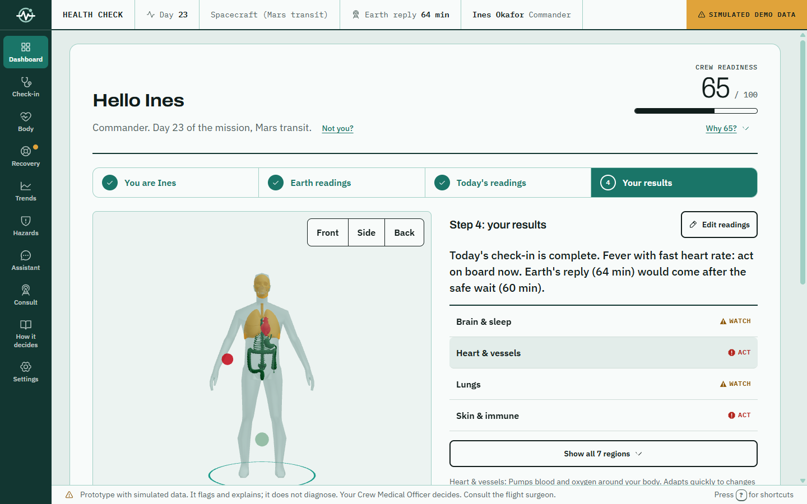

# Astronaut Health Monitor

**NASA Space Apps 2026 · prototype · simulated data**

On long missions, help from Earth is minutes to weeks away. This app is a one-minute daily health check-in for astronauts. It flags changes against each astronaut's **own normal**, explains them in plain English, and answers one question: **can this wait for Earth?**

> Not a medical device. It flags and explains; it does not diagnose and never gives doses. The Crew Medical Officer decides.



## Run it

```bash
npm install
npm run dev        # http://localhost:5173
npm test           # 66 tests, including the Monte Carlo validation
npm run build      # static, offline build in dist/ (relative paths, ready for Electron later)
```

It runs fully offline: a strict Content-Security-Policy, bundled fonts and icons, and no network calls. Data stays in the browser (IndexedDB).

## What's inside

| Screen | What it does |
|---|---|
| Who are you? | Opens the app: pick yourself from the crew and see the readings you took on Earth before launch (your normal) |
| Dashboard | A 4-step flow: you → Earth readings → enter today's readings right here → results on the 3D body, then the most urgent alert with its **Decision Panel** (safe wait vs Earth reply) and the readings log |
| Check-in | About one minute. Wearables auto-fill sleep, heart rate, temperature and radiation; you start BP, SpO₂, glucose and body mass; you enter mood, symptoms and pain |
| Measure | Guided 4-step flow per indicator: why it matters in space → how-to step cards → simulated device reading or manual entry → result with "Why this status?" |
| Body | 3D see-through body with real organ models that light up in their status colour (Sketchfab, CC-BY 4.0), and a Hairline line-drawing 2D body that marks damage with arrows (low-power aware) with a keyboard-accessible region list and region panel |
| Recovery | Red flags, drug-free on-board checklist, Crew Medical Officer escalation, decision panel per alert |
| Trends | Personal baseline band, Watch/Act limits, data-table alternative |
| Hazards | The five NASA hazards linked to live indicators |
| Assistant | Offline, pre-written answers from the condition cards; dose and diagnosis questions blocked |
| Consult | One packet for the flight surgeon with privacy toggles, reply countdown, offline queue in solar conjunction, JSON and print/PDF |
| How it decides | Formulas, constants, live Monte Carlo results, sources |
| Settings | Crew story, mission and Mars delay, conjunction, units, low-power, large text, high contrast, reduced motion |

**Demo controls:** press `Ctrl+Shift+D` to pick a crew story, step the mission day, switch the mission, and toggle conjunction. Press `?` for keyboard shortcuts.

## How it decides (short)

- Rules (condition cards as JSON) + personal baseline (10 pre-flight days on Earth) + three detectors: unusual day, slow drift, and a forecast.
- Then **T_reply > T_harm → act on board now**, otherwise ask Earth.

Measured on 300 simulated astronauts:
- 1.28 % false unusual-day flags;
- 100 % of fevers caught on day one;
- 99 % of slow BP climbs caught (median 12 days).

Details in [HOW_IT_DECIDES.md](HOW_IT_DECIDES.md).

## Project map

```
src/data/        indicators.json, conditions.json, hazards.json, regions.json (+ Zod schemas)
src/engine/      simulation, detectors, linalg, conditions, missions (T_reply), assess, assistant, validate (+ tests)
src/store/       zustand state persisted to IndexedDB (Dexie); useHealth() derives everything per day
src/screens/     one file per screen; body/ holds the 2D and 3D bodies
src/components/  status badge/shape, tiles, Decision Panel, shared UI
src/styles/      tokens (dark, high-contrast, large text), components, shell, screens
videos/          60-second concept video (HyperFrames)
```

## Docs

[PITCH.md](PITCH.md) · [HOW_IT_DECIDES.md](HOW_IT_DECIDES.md) · [DECISIONS.md](DECISIONS.md) · [REFERENCES.md](REFERENCES.md) · [APP_PREVIEW.md](APP_PREVIEW.md) · [PROMPT.md](PROMPT.md)

An AI coding assistant (Claude) helped write this code and documentation.
