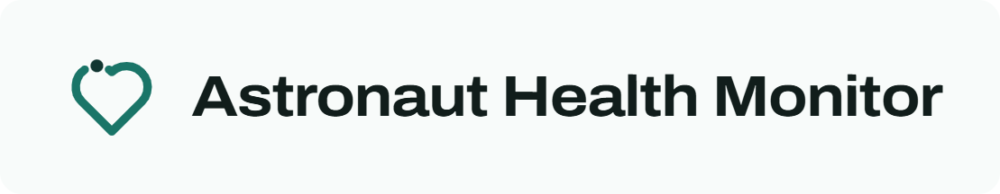

# Logo: Orbit heart

**Idea, in one sentence:** a heart drawn as one orbit line, with a small craft riding it, meaning health looked after far from Earth.

Chosen by the team on 2026-11-15 from three concepts (A "Can it wait", B "Orbit heart", C "Helmet heart"); a merge of A and B was tried and dropped because it read as a check mark or a broken heart. Made with the logo-design skill: built in SVG, audited (`svg_audit.py`, 98 to 99/100), tested at 16 to 96 px, in one colour, reversed, and on the app tile.

## Construction

- Heart: a square rotated 45° (side 100 on a 256 grid) plus two circles of radius 50 on its upper sides; exact 45° lines.
- Drawn as a 20-unit line with round ends. A real gap in the line (35° each side of the top of the left lobe) leaves 5 units of clear space around the craft, a dot of radius 15. No masks or painted-over keylines, so it works on any background.
- Small-size cut (`symbol-small.svg`, used for favicons and the app icon): 28-unit line, wider gap, craft radius 17.

## Files (`final/`)

| File | Use |
|---|---|
| `symbol.svg` | Primary mark on light backgrounds (teal line, deep-teal craft) |
| `symbol-on-dark.svg` | On deep teal or dark backgrounds (light-teal line, white craft); used in the app's menu rail |
| `symbol-small.svg` | 16 to 32 px |
| `app-icon.svg` | Desktop and app icon: the small cut on the deep-teal tile (`build/icon.png` is its 1024 px render) |
| `lockup-horizontal.png`, `lockup-horizontal-on-dark.png` | Mark plus name, for documents and the README |
| `export/` | One-colour black, white and deep-teal versions, favicon set, web manifest |

## Colours

| Role | Hex |
|---|---|
| Line (light backgrounds) | `#1A7568` primary teal |
| Craft, tile | `#123631` deep teal |
| Line on dark | `#9FCFC4` light teal |
| Craft on dark | `#F8FBFA` paper |

One-colour use: all deep teal `#123631`, all black, or all white.

## Rules

- **Clear space:** at least the craft's diameter (30 units at 256) on every side.
- **Minimum size:** 24 px for `symbol.svg`; below that use `symbol-small.svg` (down to 16 px).
- **Name:** set in Archivo Bold at 112 % width, tracking −0.02 em, beside the mark at about 1.9 times the cap height. The wordmark in the lockup PNGs is rendered from the font; vector outlines of the name are an open item.
- **Don't:** recolour the craft to red or amber (those mean health status in the app), fill the heart, close the gap, add shadows or gradients, or rotate the mark.

## Honesty

A trademark search has not been done; a heart with an orbiting dot is simple enough that a professional search is advised before any commercial use.
